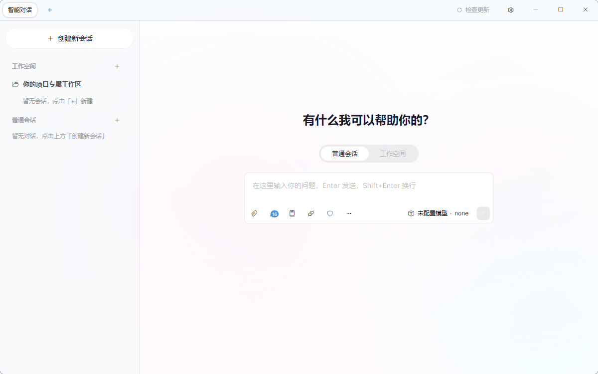
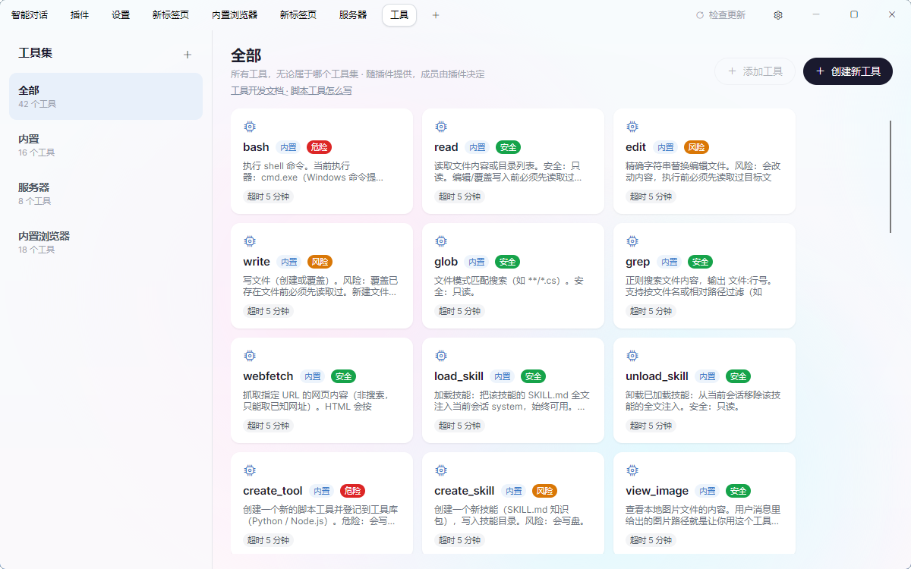
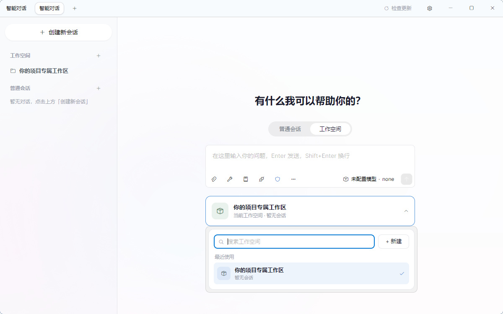
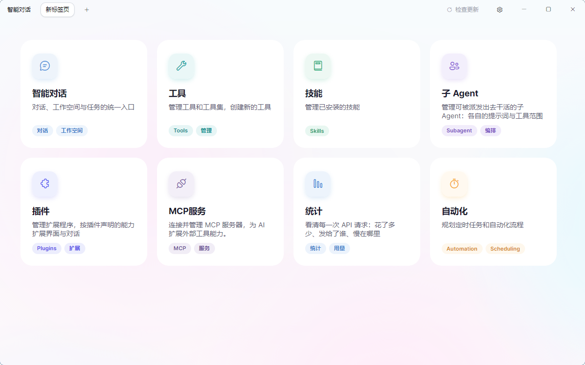
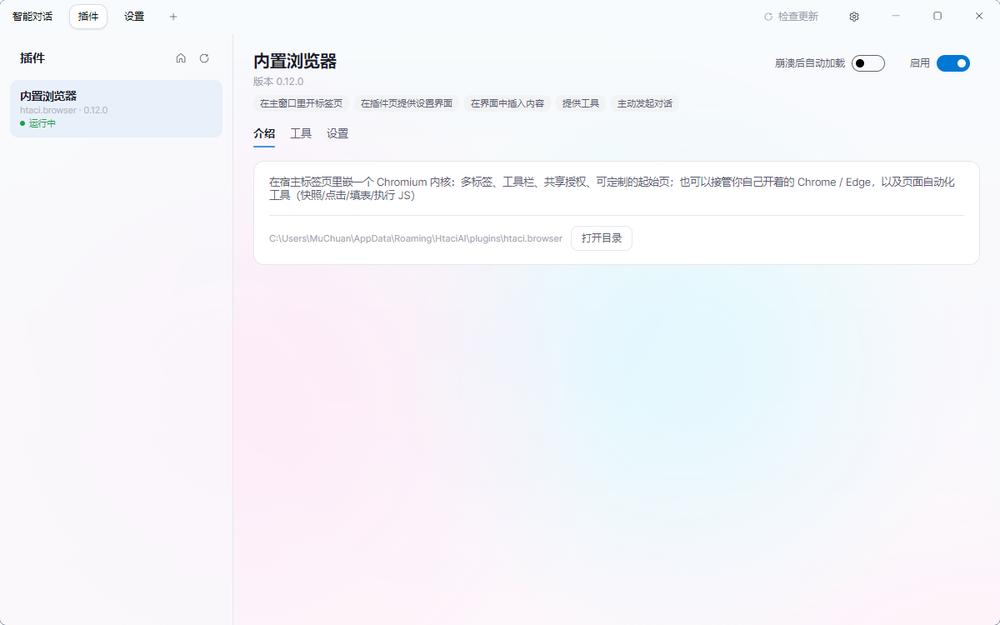
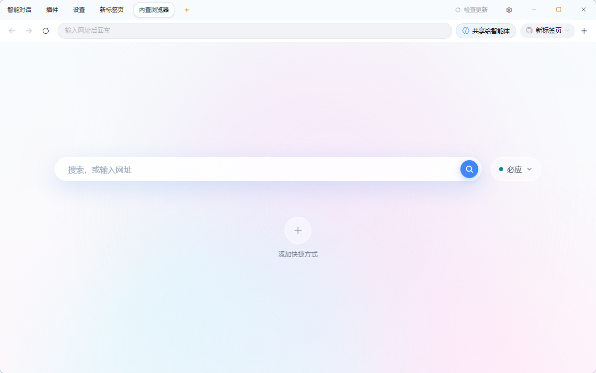
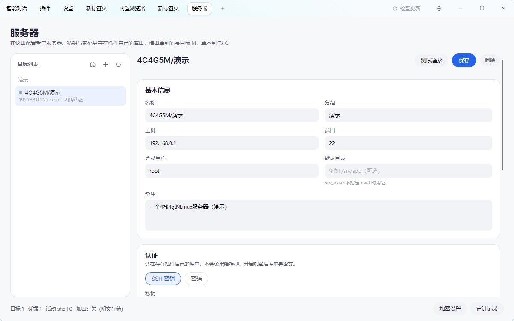

# HtaciAI

[中文](README.md) | English

**A free, open-source AI desktop client written in C# / Avalonia. Built to handle complex tasks at a small footprint, lightweight, clean, and fully featured. It iterates on itself and gets more comfortable the longer you use it.**

[](https://dotnet.microsoft.com/)
[](https://avaloniaui.net/)
[](LICENSE)
[](#)

It is a general-purpose agent, not just a chat box. It handles everyday work — drafting documents, looking things up, tidying files, running scripts — and when you point a workspace at a project directory, it reads, edits and runs commands in that project directly. Daily tasks and development tasks use the same set of tools, so you do not have to switch between two applications.



## Features

**Sessions and workspaces**
- Separate panes for plain chats and workspaces. A workspace is bound to a local directory, so the AI reads and writes files and runs commands in a real folder, dispatching tasks onto your own project
- Paste and upload attachments, edit messages, automatic context compaction, per-session view state caching
- Multiple tabs: several conversations and the built-in browser open side by side without interfering

**Model providers**
- 20 built-in provider presets that fill in the endpoint and protocol for you: DeepSeek, OpenAI, Anthropic, Moonshot, Zhipu, Z.ai, MiniMax, Grok, Xiaomi MiMo, SiliconFlow, Alibaba Cloud Bailian, Volcengine, Tencent Hunyuan, Tencent Cloud, Mistral, LongCat, Hugging Face, Ollama, LM Studio and more
- Supports the OpenAI Chat Completions, OpenAI Responses, Anthropic Messages and LM Studio protocols, and any compatible endpoint can be added manually
- Streaming output, retries, adapters for reasoning fields, automatic model discovery

**Tools and skills: it adapts to you as you use it**
- The built-in tools only cover the basics — reading and writing files, running commands, searching code, fetching pages. The point is not how many tools ship, but that the set can be changed and extended
- When something is missing, the AI builds it on the spot: `create_tool` writes a Python / Node.js script tool and registers it in the tool library for later reuse, while `create_skill` writes a `SKILL.md` that captures a working method as a skill
- Both libraries are ordinary files on disk. Writing one by hand works just as well, and anything can be edited or removed at any time
- Over time the agent grows with your habits: frequently used additions accumulate, unused ones are dropped, and it fits your own work better the longer you keep it
- Tools carry a risk level, and mutating operations (writing files, editing, executing commands) go through a permission review; skills are loaded and unloaded on demand, with their text injected into the system prompt



**MCP servers**
- Connect MCP servers to extend the AI with external tools
- Supports the stdio, SSE and Streamable HTTP transports

**Sub-agents**
- Dispatch tasks to independent sub-agents, each with its own prompt and tool scope
- Sub-agent profiles can be saved and reused, for scenarios such as parallel research or an independent review

**Plugin system**
- Plugins are loaded as standalone DLLs and declare their capabilities in a manifest (main-window tabs, settings pages, embedded page content, provided tools, initiating conversations)
- Host and plugins are coupled only through the `HtaciAI.Plugin.Abstractions` contract. Plugin code is not part of this repository and is maintained separately
- There are two plugins, both written by the author of this project and usable as references for writing your own: a built-in browser (multi-tab Chromium core with page automation tools) and a servers plugin (SSH target management, command execution, file transfer)

**Statistics and observability**
- Every API request is recorded: how much it cost, which provider handled it, and where the time went

## Screenshots

| New chat | Workspace picker |
|---|---|
|  |  |

| New tab | Plugin management |
|---|---|
|  |  |

| Built-in browser | Servers plugin |
|---|---|
|  |  |

## Download and run

Released builds are on [Releases](https://github.com/Htaci/HtaciAI/releases). The in-app update check compares against the version in the update manifest.

- Windows / Linux / macOS: unzip and run. Data lives in a `data/` directory next to the executable (portable mode)
- Android / iOS / WebAssembly: the repository contains the corresponding projects (`net10.0-android`, `net10.0-ios`, `net10.0-browser`)

## Build from source

Requires the .NET 10 SDK.

```bash
git clone https://github.com/Htaci/HtaciAI.git
cd HtaciAI
dotnet build HtaciAI.slnx
dotnet run --project HtaciAI.Desktop
```

Single-file publish:

```bash
dotnet publish HtaciAI.Desktop -c Release -r win-x64 --self-contained
```

## Repository layout

```
HtaciAI/                     Core: views, controls, services, data layer
HtaciAI.Desktop/             Desktop entry point
HtaciAI.Shared/              Cross-platform shared code
HtaciAI.Android/             Android entry point
HtaciAI.iOS/                 iOS entry point
HtaciAI.Browser/             WebAssembly entry point
HtaciAI.Mobile/              Shared mobile code
HtaciAI.Plugin.Abstractions/ Plugin contract (the copy both host and plugins reference)
HtaciAI.Tests/               Tests
tools/ModelTableGen/         Built-in model table generator
docs/                        Design documents
```

Stack: Avalonia 12 + CommunityToolkit.Mvvm + Microsoft.Data.Sqlite.

## Documentation

| Document | Contents |
|---|---|
| [plugin-manifest.md](docs/plugin-manifest.md) | Plugin manifest specification |
| [plugin-handoff.md](docs/plugin-handoff.md) | Plugin internals and known issues |
| [plugin-servers.md](docs/plugin-servers.md) | Servers plugin design |
| [model-table.md](docs/model-table.md) | Built-in model table and generator |
| [shell-tool.md](docs/shell-tool.md) | Shell tool and script runtimes |
| [api-stats.md](docs/api-stats.md) | API request statistics |
| [icon-glyphs.md](docs/icon-glyphs.md) | Icon glyph codepoints |

## License

[Apache License 2.0](LICENSE)
