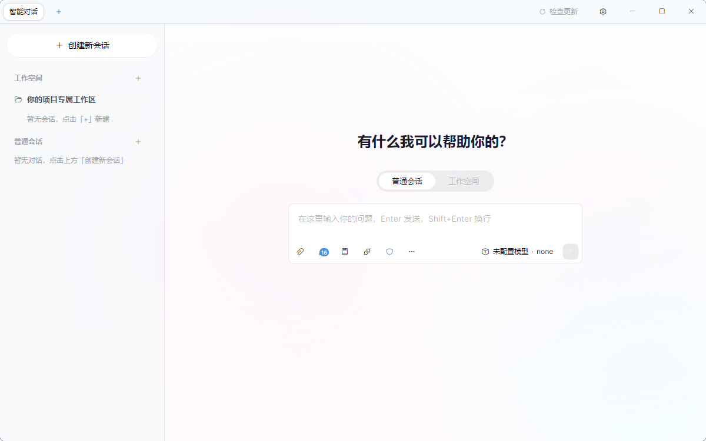
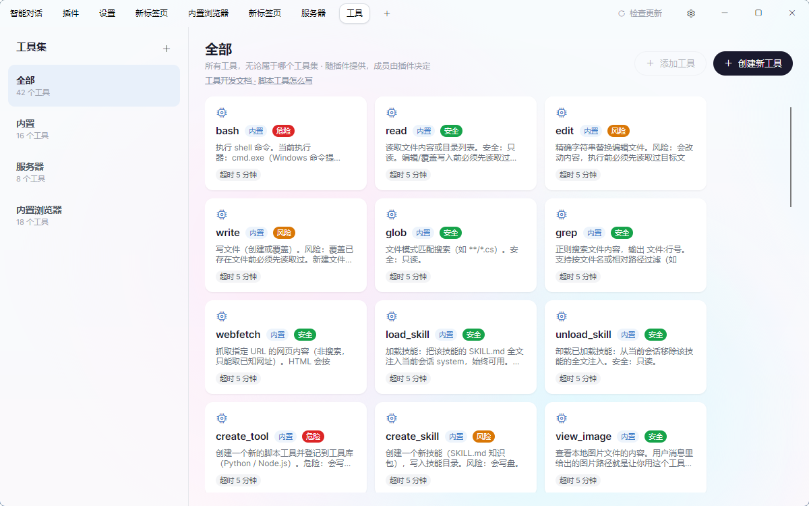
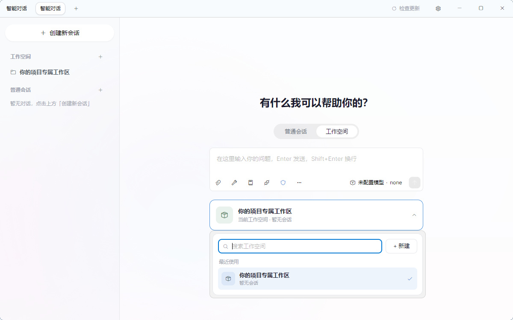
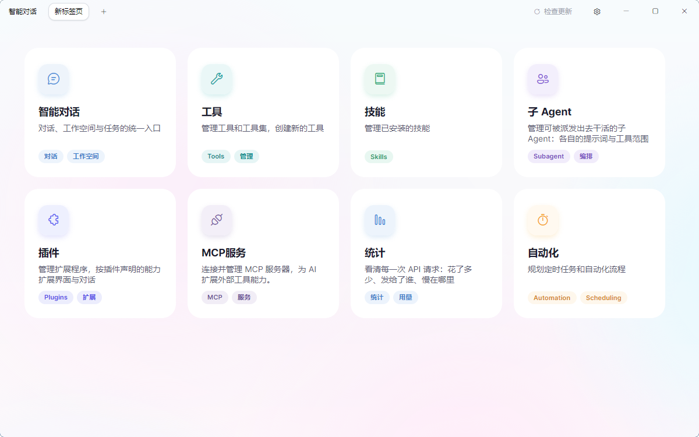
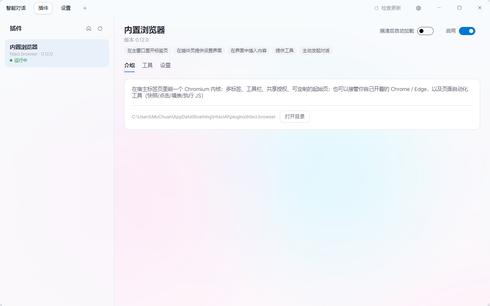
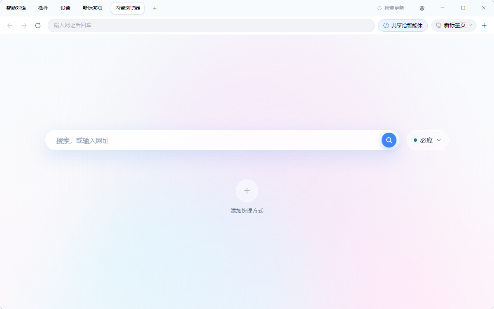
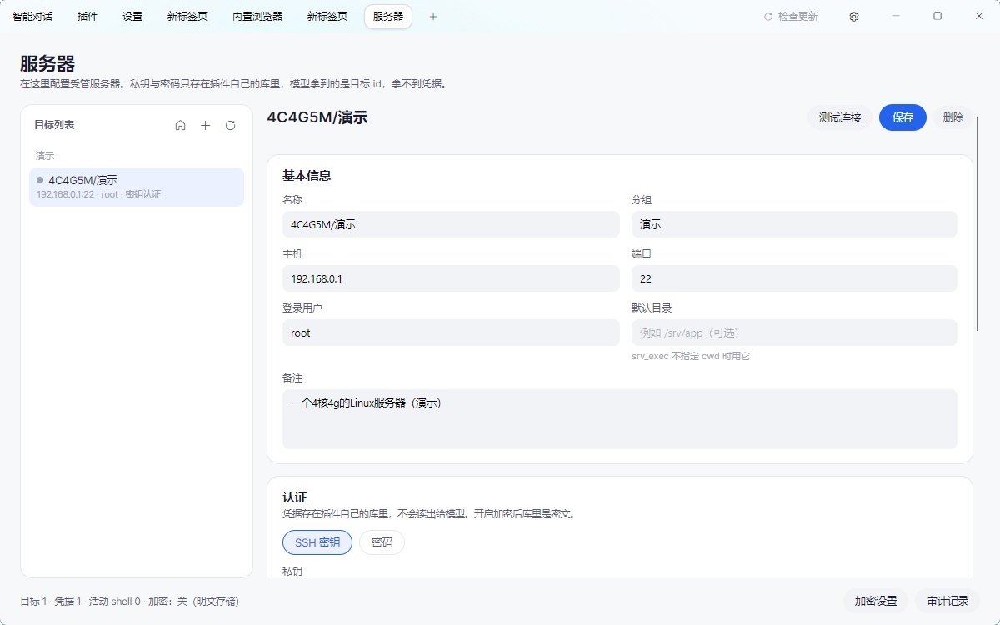

# HtaciAI

中文 | [English](README.en.md)

**一个开源免费的 AI 桌面客户端，用 C# / Avalonia 写成。以小体积完成复杂任务为目标，轻量、简洁、功能完整，自我迭代，越用越舒服，不烧心。**

[](https://dotnet.microsoft.com/)
[](https://avaloniaui.net/)
[](LICENSE)
[](#)

它是一款通用型 Agent，而不是一个聊天框。写文档、查资料、整理文件、跑脚本，这些日常杂活能干；把工作空间指到一个项目目录，它就能直接读代码、改代码、执行命令，项目开发也是同一套工具。日常任务和开发任务不需要切换成两个软件。



## 特性

**会话与工作空间**
- 普通会话与工作空间分栏管理。工作空间绑定一个本地目录，AI 在真实目录里读写文件、跑命令，任务派发到用户自己的项目上
- 附件粘贴与上传、消息编辑、上下文自动压缩、按会话缓存视图状态
- 多标签页，一次开多个会话与内置浏览器互不干扰

**模型服务商**
- 内置 20 个预设服务商，一键填好地址与协议：DeepSeek、OpenAI、Anthropic、Moonshot、智谱、Z.ai、MiniMax、Grok、小米 MiMo、硅基流动、阿里云百炼、火山引擎、腾讯混元、腾讯云、Mistral、LongCat、Hugging Face、Ollama、LM Studio 等
- 支持 OpenAI Chat Completions、OpenAI Responses、Anthropic Messages、LM Studio 四种协议，也可手动添加任意兼容接口
- 流式输出、重试、思考字段适配、模型目录自动发现

**工具与技能：越用越贴合你**
- 内置工具只覆盖最基础的几件事——读写文件、跑命令、搜代码、取网页。工具不在多，够用来改和扩
- 不够用就让 AI 现场造：`create_tool` 写一个 Python / Node.js 脚本工具并登记进工具库，下次直接复用；`create_skill` 写一份 SKILL.md，把一套做法沉淀成技能
- 工具库和技能库都是磁盘上的普通文件，自己手写一份同样生效，也能随时改、随时删
- 于是它跟着你的习惯长：常用的一次次攒下来，用不上的清掉，用得越久越贴合你自己的活儿
- 工具带危险等级标注，改动型操作（写文件、编辑、执行命令）走权限审核；技能在会话中按需加载与卸载，正文注入 system prompt



**MCP 服务**
- 接入 MCP 服务器，为 AI 扩展外部工具能力
- 支持 stdio、SSE、Streamable HTTP 三种传输

**子 Agent**
- 把任务派发给独立的子 Agent，各自带提示词与工具范围
- 可预设并复用子 Agent 配置，用于并行调研、独立审查这类场景

**插件系统**
- 插件以独立 dll 形式加载，由插件清单声明能力（主窗口标签页、设置界面、页面内嵌内容、提供工具、主动发起对话）
- 插件与宿主只通过 `HtaciAI.Plugin.Abstractions` 契约耦合，插件本体不在本仓库内，按自己的节奏单独维护
- 现有插件两个，均由本项目作者开发，可作为编写插件的参照：内置浏览器（Chromium 内核多标签 + 页面自动化工具）、服务器（SSH 目标管理、命令执行、文件传输）

**统计与可观测**
- 记录每一次 API 请求：花了多少、发给谁、慢在哪里

## 界面预览

| 新建会话 | 工作空间选择 |
|---|---|
|  |  |

| 新标签页 | 插件管理 |
|---|---|
|  |  |

| 内置浏览器 | 服务器插件 |
|---|---|
|  |  |

## 下载与运行

发布版本见 [Releases](https://github.com/Htaci/HtaciAI/releases)。应用内「检查更新」会比对更新清单里的版本号。

- Windows / Linux / macOS：解压即用，数据默认放在 exe 同级的 `data/` 目录（便携模式）
- Android / iOS / WebAssembly：仓库内含对应工程（`net10.0-android`、`net10.0-ios`、`net10.0-browser`）

## 从源码构建

需要 .NET 10 SDK。

```bash
git clone https://github.com/Htaci/HtaciAI.git
cd HtaciAI
dotnet build HtaciAI.slnx
dotnet run --project HtaciAI.Desktop
```

打包单文件发布：

```bash
dotnet publish HtaciAI.Desktop -c Release -r win-x64 --self-contained
```

## 项目结构

```
HtaciAI/                     核心：视图、控件、服务、数据层
HtaciAI.Desktop/             桌面入口
HtaciAI.Shared/              跨平台共享
HtaciAI.Android/             Android 入口
HtaciAI.iOS/                 iOS 入口
HtaciAI.Browser/             WebAssembly 入口
HtaciAI.Mobile/              移动端共享
HtaciAI.Plugin.Abstractions/ 插件契约（宿主与插件共同引用的那一份）
HtaciAI.Tests/               测试
tools/ModelTableGen/         内置模型表生成器
docs/                        设计文档
```

技术栈：Avalonia 12 + CommunityToolkit.Mvvm + Microsoft.Data.Sqlite。

## 文档

| 文档 | 内容 |
|---|---|
| [plugin-manifest.md](docs/plugin-manifest.md) | 插件清单规范 |
| [plugin-handoff.md](docs/plugin-handoff.md) | 插件机制交接与已知问题 |
| [plugin-servers.md](docs/plugin-servers.md) | 服务器插件设计 |
| [model-table.md](docs/model-table.md) | 内置模型表与生成器 |
| [shell-tool.md](docs/shell-tool.md) | Shell 工具与脚本运行时 |
| [api-stats.md](docs/api-stats.md) | API 请求统计 |
| [icon-glyphs.md](docs/icon-glyphs.md) | 图标码位表 |

## 许可证

[Apache License 2.0](LICENSE)
